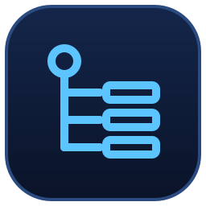

  

  
   
  <b>Made by Bali</b> · Copenhagen
    
  
  
  
  

### Tools for Claude Code

<table>
  <tr>
    <td width="88" valign="top">
      
    </td>
    <td valign="top">
      <a href="https://github.com/balazsarany9619/dojo-for-claude-code"><b>dojo for claude code</b></a> 
      A multi-session terminal app for Claude Code. Every project folder one click away, live status per session, focus and grid view, stats.
    </td>
  </tr>
  <tr>
    <td width="88" valign="top">
      
    </td>
    <td valign="top">
      <a href="https://github.com/balazsarany9619/brain-starter-kit"><b>brain starter kit</b></a> 
      Give Claude Code a permanent memory. Global brain, project brains with topic files, rules that maintain themselves. Setup in 10 minutes of multiple-choice questions.
    </td>
  </tr>
</table>

* * *

### See it in action

Dojo radar: every project, its last change and the next step at a glance.

Brain Starter Kit: one folder per project, topics, log and rules Claude reads every session.

* * *

### What I'm into

Vibe coding · Claude Code workflows · agent memory · hackathons in Copenhagen

### Say hi

[GitHub](https://github.com/balazsarany9619)
